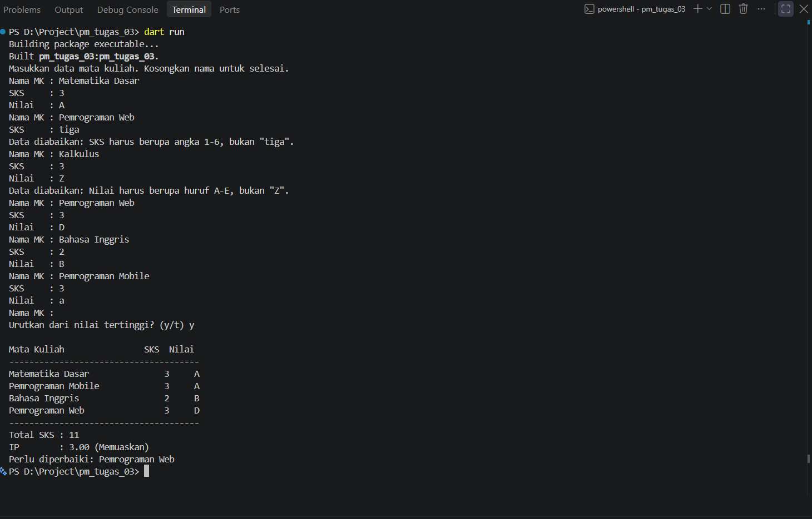

# Tugas Rutin 3: Kalkulator IP Semester

## Identitas
- Nama: Jhon Gabriel Simarmata
- NIM: 4243550020
- Kelas: PSIK 24C
- Mata Kuliah: Pemrograman Mobile (3KOM40215)

## Cara menjalankan
1. Pastikan Dart SDK sudah terpasang.
2. Buka terminal di folder proyek.
3. Ambil dependensi dan jalankan program:
   ```bash
   dart pub get
   dart run
   ```

## Tempat tangkapan layar


## Penjelasan
Program ini menggunakan higher-order function untuk mengolah data KHS secara ringkas. Fungsi `totalSks()` memakai `fold` untuk menjumlahkan SKS, sedangkan `hitungIp()` menggunakan `fold` lagi untuk mengakumulasi hasil perkalian SKS dengan bobot nilai, lalu membaginya dengan total SKS. Fungsi `daftarPerluDiperbaiki()` menerapkan `where` agar hanya mata kuliah berbobot di bawah dua yang dipilih. Pada `cetakKhs()`, data disalin terlebih dahulu, kemudian `sort` memakai fungsi pembanding yang membandingkan bobot nilai secara menurun; jika bobot sama, nama menjadi pengurut kedua. Dengan demikian, urutan data asli tetap dipertahankan. Untuk validasi masukan, `validasiSks()` memeriksa bilangan bulat satu sampai enam dan `validasiNilai()` memeriksa nilai A sampai E; keduanya melempar `FormatException` ketika masukan tidak sah. Fungsi `main()` membaca nama, SKS, dan nilai dalam satu blok `try`, lalu menangkap exception tersebut dengan `on FormatException catch`, menampilkan pesan bahwa entri diabaikan, dan kembali meminta nama mata kuliah berikutnya. Nilai huruf kecil dinormalisasi sebelum pemetaan bobot, sementara EOF mengakhiri pengumpulan data tanpa mengulang prompt. Pemisahan tugas membuat alur mudah ditelusuri.

## Pernyataan penggunaan AI
Saya menggunakan AI (Claude) untuk membantu menyusun sebagian kode. Saya menjalankan dan menguji program dengan berbagai input, serta mempelajari cara kerjanya.
